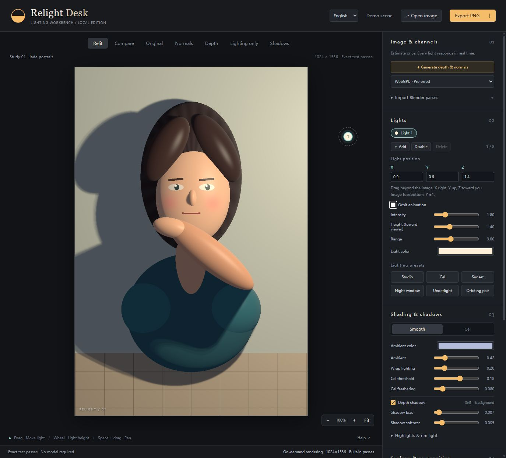

# Relight Desk

[简体中文](README.md)

Local image relighting with real-time lights, depth-based self-shadows and background shadows. An independent implementation inspired by AiDeNier's video, not the original author's release. It does not regenerate your image.



## Quick start

1. Install [Node.js 24 LTS](https://nodejs.org/) (24.5 or newer), then reopen your terminal.
2. Download this repository using **Code → Download ZIP** and extract it.
3. Open a terminal in the folder containing `package.json` and run:

```sh
npm start
```

The launcher installs locked dependencies, downloads and verifies about 99 MB of model files, builds the app, and starts a read-only local server at **http://127.0.0.1:5178/**. Keep the terminal open; Ctrl+C stops it. Use `npm.cmd start` if PowerShell blocks `npm.ps1`.

First-time setup needs internet. Later starts reuse verified models and installed dependencies if the lockfile is unchanged. No Python, CUDA toolkit, account, or paid API is required. Inference uses browser WebGPU or slower WASM/CPU; rendering requires WebGL2 with floating-point targets.

## Use

Try the built-in scene. Open a PNG/JPEG/WebP, generate depth and normals, then drag lights inside or outside the image. Edit X/Y/Z for precision. Scroll over the image to adjust light height; Space+drag pans. Export PNG, normal PNG, floating-point PFM, and settings JSON. Chinese/English switching is available in the top bar.

## Model management

Weights are ordinary files under `models/onnx-community/depth-anything-v2-small/`, **not browser Cache Storage**. Your browser reads them from the local server and runs inference on your computer. No image upload endpoint exists.

```sh
npm start -- --model-dir "D:\Models\RelightDesk"
npm start -- --port 5180
npm start -- --no-open
npm run models:download
npm start -- --demo-only
```

`RELIGHT_MODEL_DIR` is also supported; the CLI option wins. Files are pinned to a revision and SHA-256 hashes in `model-manifest.json`. Valid files are reused without a download request; incomplete files restart from scratch. Invalid files are preserved as `.invalid-*` backups before replacement. Standard HTTP_PROXY/HTTPS_PROXY variables are supported. Weights and user images are not committed to Git.

Depth Anything V2 Small FP32 estimates relative depth. Normals are derived using GPU shaders, without a second model. Clearing browser data does not remove disk files. Older browser caches are neither migrated nor deleted.

## Blender and limitations

Import matching-resolution camera-space normals and relative depth as PNG or standalone RGB EXR. X right, Y up, Z toward the viewer. Do not apply color transforms to data. Multilayer EXR is unsupported. See the [advanced guide](docs/ADVANCED.md).

This is fixed-view 2.5D relighting, not full 3D reconstruction. Existing baked lighting is not removed. Hidden geometry, hair and illustrations may have inaccurate estimated depth. The procedural demo is not proof of parity with the reference artwork.

The launcher binds to localhost only; it does not publish a website. Public hosting requires HTTPS and explicit model routes as well as the frontend. Copying `dist/` alone is not a complete model-enabled deployment.

## Development

```sh
npm ci
npm run models:download
npm run dev -- --port 5178
npm test
npm run build
```

See [deployment verification](verification/DEPLOYMENT.md) for tested and untested behavior. Windows/Linux CI is configured; its result depends on the repository's actual Actions run.

See [third-party notices](THIRD_PARTY_NOTICES.md). A license for this project's own source has not yet been selected by its owner.
