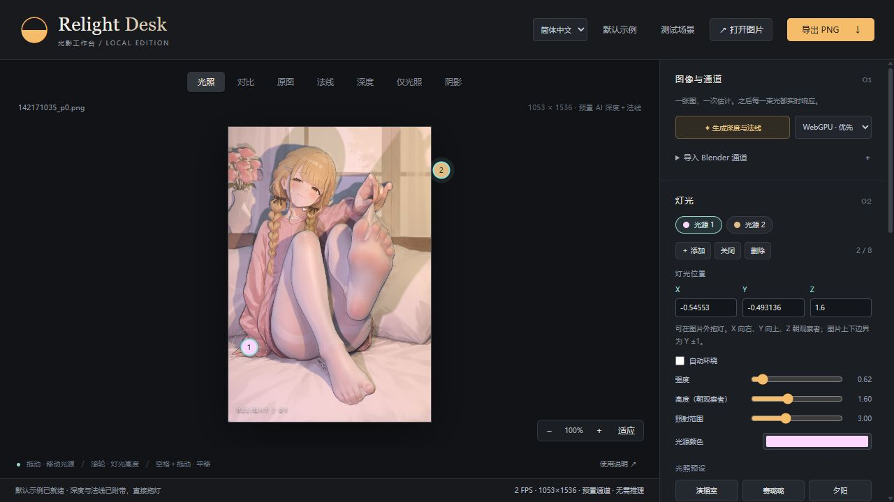

# Relight Desk · 光影工作台

**给一张图片重新打光：拖动灯光，实时查看明暗、人物内部遮挡与背景投影。**

[English](README.en.md) · [Blender / 进阶说明](docs/ADVANCED.md) · [验证记录](verification/DEPLOYMENT.md)



这是一个独立实现的本地网页工具，灵感来自 AiDeNier 的 Relight Desk 视频，并非原作者发布的软件。**不是生成式改图**：保留原图，用深度和法线实时计算光照。默认插画由项目维护者提供，附带预计算 AI 深度与法线；另保留程序化测试场景，不宣称与原视频质量相同。

## 能做什么

- 单张 PNG / JPEG / WebP 自动估计浮点深度，再由深度生成法线。
- 最多 8 盏灯；图片内外拖动、X/Y/Z 精确输入、颜色、强度、范围、环绕动画。
- 高度场光线步进投影：人物内部遮挡和背景软阴影，不是简单平移剪影。
- 普通 / 赛璐璐模式，环境光、高光、边缘光、曝光与效果混合。
- 原图对比、法线、深度、仅光照和阴影调试视图。
- Blender 独立 RGB EXR / PNG 深度、法线与影响蒙版导入。
- PNG、法线 PNG、浮点 PFM、灯光设置 JSON 导出；简体中文 / English 即时切换。

## 新手快速开始

### 1. 安装 Node.js

安装 [Node.js 24 LTS](https://nodejs.org/)（最低 24.5）。它会一并安装 npm。安装后重新打开终端，执行 `node --version` 检查版本。

推荐使用桌面 Chrome 或 Edge，并打开浏览器硬件加速。不需要 Python、CUDA、账号或付费 AI API。WebGPU 不可用时，界面可选较慢的 WASM / CPU 推理；实时画布仍需要 WebGL2。

### 2. 下载并解压项目

在本仓库页面选择 **Code → Download ZIP**，解压到你想保存的位置。在解压后的文件夹中打开终端，确认该目录里有 `package.json`。

Windows：可在文件夹空白处右键选择“在终端中打开”。

### 3. 只运行这一条命令

```sh
npm start
```

启动程序会依次：安装锁定版本的依赖 → 准备并校验约 **99 MB** 模型 → 构建网页 → 启动本地服务 → 尝试打开浏览器。

看到 `READY / 已启动` 后访问 **http://127.0.0.1:5178/**。保持终端开启；按 `Ctrl+C` 停止。以后仍执行 `npm start`，依赖和完整模型会复用。

> 第一次需要联网下载依赖和模型。已经准备齐全、依赖锁文件没有改变时，后续启动无需重新从网络下载它们。不是无需安装环境的独立 EXE。
>
> PowerShell 如果提示 `npm.ps1` 被执行策略阻止，改用 `npm.cmd start`，无需降低系统执行策略。

## 第一次使用

1. 打开后直接在默认插画上拖灯，深度和法线已经附带，无需点击生成。点击「测试场景」可切换到程序化肖像，检查精确通道的手臂遮挡和墙面投影；「默认示例」可切回插画。
2. 点击「打开图片」，再点「生成深度与法线」。这是**你的电脑**在做推理，不上传图片。
3. 拖动灯位圆点或中央空白区，也可在右侧输入 X / Y / Z。滚轮改变高度；空格＋拖动平移图片。
4. 调节深度强度、投影柔和度、环境光和效果混合。
5. 点击「导出 PNG」。保存设置 JSON 可留住灯位和参数；图片/通道需另行保存。

模型生成深度时才运行 AI。法线和后续拖灯由 WebGL 着色器实时计算，不会每拖一次灯就重新推理。

### 自带示例与通道

`public/example/` 包含原图 `original.png`（2071×3021）、展示图 `color.png`（1053×1536）、同尺寸 `normal.png` 和 `depth.f32`。展示图仅等比缩小，不裁切；原图字节保持不变。

- 深度由本地 Depth Anything V2 Small FP32 预计算，`depth.f32` 为小端 Float32、从上到下、0—1 近白的相对深度；`depth-preview.png` 仅用于预览，不参与投影计算。
- 法线从浮点深度保边平滑后派生，RGB 解码为 `RGB × 2 − 1`，X 向右、Y 向上、Z 朝观察者。更改深度强度、平滑或反转后，会即时重新派生法线，不会重新运行 AI。
- 初始打开只读取已附带通道，不请求模型。只体验示例可运行 `npm start -- --demo-only`，连模型下载也跳过；上传其他图片并生成深度时仍需要模型。
- 示例专属灯光保存在 `public/example/settings.json`：维护者手动调整的粉紫补光＋暖色主光及完整渲染参数。首次打开、点击「默认示例」、在该示例上重置灯光时均恢复这套设置；其他图片和测试场景不受影响。
- `manifest.json` 记录模型版本、尺寸、生成参数及文件 SHA-256；维护者可用 `node scripts/bake-example.mjs "图片路径.png"` 重生成通道（需要先准备本地模型）。
- 插画不是本项目原创素材，不因随仓库分发而获得新的许可；再分发或商用前请自行确认原作者授权，见 [第三方说明](THIRD_PARTY_NOTICES.md)。

## 模型放在哪里？会重复下载吗？

现在是**普通磁盘文件，不再依赖浏览器模型缓存**：

```text
relight-desk/
└─ models/
   └─ onnx-community/
      └─ depth-anything-v2-small/
         ├─ config.json
         ├─ preprocessor_config.json
         └─ onnx/model.onnx
```

- 模型：Depth Anything V2 Small ONNX，FP32。法线无需额外模型。
- 固定上游版本、文件大小、SHA-256 见 [model-manifest.json](model-manifest.json)。
- 每次启动校验本地文件，**完整文件直接复用，不发模型下载请求**。缺失/损坏才重新下载；已有损坏文件保留为 `.invalid-*` 备份。
- 临时下载经完整校验后才成为正式文件。中断后重跑即可；未完成的单个文件从头下载，不宣称支持断点续传。
- 清理浏览器缓存、换浏览器，不会删除这里的文件。浏览器仍需从本机读取权重到内存，这不是再次从互联网下载。
- 模型没有提交到 GitHub；旧版 `transformers-cache` 不自动迁移或删除。

### 想放到 D 盘？

```sh
npm start -- --model-dir "D:\Models\RelightDesk"
```

指定的是模型根目录，程序会在里面保留上图的 `onnx-community/depth-anything-v2-small/` 结构。以后使用同一参数即可，也可设置 `RELIGHT_MODEL_DIR` 环境变量，不需要修改源码。

将现有 `models` 内的 `onnx-community` 文件夹复制到新根目录，可复用已有权重；不要只复制 ONNX 文件。启动程序会验证复制结果。

## 常用命令

| 需求 | 命令 |
|---|---|
| 正常启动 | `npm start` |
| 指定模型目录 | `npm start -- --model-dir "D:\Models\RelightDesk"` |
| 5178 已被占用 | `npm start -- --port 5180` |
| 不自动打开浏览器 | `npm start -- --no-open` |
| 只下载 / 校验模型 | `npm run models:download` |
| 暂不下载模型，只看内置场景或导入通道 | `npm start -- --demo-only` |
| 查看参数 | `npm start -- --help` |

`--demo-only` 仍需要网页依赖；第一次安装依赖仍需联网。没有模型时会明确提示准备模型，不用亮度图假冒 AI。

## 常见问题

**下载失败怎么办？** 终端会显示具体失败文件。检查网络是否能访问 npm 和 Hugging Face，再执行同一命令。支持标准 `HTTPS_PROXY` / `HTTP_PROXY` 环境变量；不内置第三方镜像，不把代理密码写进仓库。已通过校验的文件不会重下。

**浏览器无法打开？** 先等终端出现 `READY`，再打开打印的地址。端口被占用时改用 `--port 5180`；不要直接双击 `index.html` 或使用 `file://`。

**没有独立显卡能用吗？** 可尝试 WASM 推理，但会慢很多；画布还要求支持浮点渲染目标的 WebGL2。低端设备性能不作保证，可先用小图测试。

**离线能用吗？** 依赖、模型和项目文件准备好后，可断网在本机使用。单独复制 `dist/` 不包含磁盘模型；迁移时同时保留项目与模型目录，或重新运行启动命令。

**这是云端服务吗？** 不是。Node 只准备文件并提供本机只读 HTTP 服务，默认只监听 `127.0.0.1`；推理在浏览器中执行，不在 Node 或云端执行。它不会把网页公开到互联网。

## Blender 用户

有准确的深度与法线时，不必运行 AI。所有通道必须来自同一相机、同一分辨率。

- 法线转到**相机空间**：X 右、Y 上、Z 朝观察者。
- PNG 法线编码为 `N * 0.5 + 0.5`；RGB EXR 保留有符号 XYZ。
- 深度用灰度 PNG 或把深度复制到 RGB 的独立 EXR。
- 不对数据通道套用 AgX、Filmic 或 sRGB 颜色变换。
- 首版不解析多层 EXR，也不重建真实相机空间。

详见 [Blender 通道约定、导出格式与实现说明](docs/ADVANCED.md)。

## 效果与限制

这是固定视角 **2.5D 高度场重打光**，不是完整三维场景，也不是自动去除旧光影的生成式工具。原图已有阴影仍可能残留；看不见的几何、细发丝、透明物体和交叠肢体可能估计不准确。准确 Blender 通道通常比 AI 猜测更可靠。

不支持视频逐帧处理、Blender 插件、真实米制 Position 重建或窗格投影。不承诺对所有插画都达到参考视频质量。

## 来源与许可

参考 [Transformers.js 官方示例](https://github.com/huggingface/transformers.js-examples)的 Vite / 浏览器推理组织方式，以及[本地模型加载文档](https://huggingface.co/docs/transformers.js/v3.0.0/custom_usage)。磁盘模型管理和一键启动逻辑由本项目实现。

